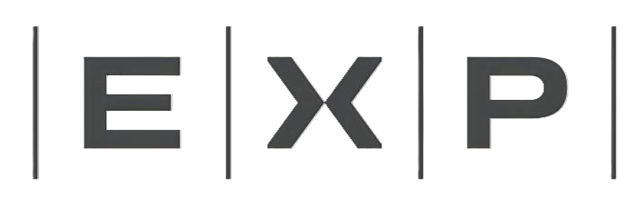

# EXP · Diretriz de Verificação Estética de Módulos

Documento de referência derivado do cross-check realizado nos módulos ativos da plataforma.  
Batido contra `exp-design-system.css` — Junho 2026.

---

## 1. Shell — Área-Limite do Módulo

Todo módulo deve ocupar sua área com um **card flutuante** ou uma **composição de cards**. Nunca conteúdo solto direto sobre o fundo `--off`.

| Tipo de módulo | Estrutura esperada |
|---|---|
| Simples | Um card: `flex:1` com `--radius-shell` |
| Com sidebar | Sidebar (largura fixa) + card principal |
| Chat / painéis | Nav lateral + sidebar + main |

**CSS obrigatório no card de módulo:**
```css
background:    var(--branco);
border:        1px solid var(--cinza2);  /* shell usa --cinza2, mais suave */
border-radius: var(--radius-shell, 14px);
overflow:      hidden;
```

> **Distinção de borda:** o shell usa `--cinza2` (borda leve, `#ECEAE4`). Cards internos (`.card`) usam `--cinza` (borda mais firme, `#D0CFC9`). Nunca inverter.

**Dark mode — obrigatório:**
```css
[data-theme="dark"] #meu-modulo { background: #1E1E1D; border-color: #2E2D2B; }
```

> `#1E1E1D` é o fundo de shell escuro — ligeiramente mais claro que `--branco` dark (`#1C1C1A`), preservando a profundidade da camada.  
> `#2E2D2B` é o divisor de shell — ligeiramente mais claro que `--cinza2` dark (`#2A2A28`).

**Verificar:**
- [ ] Card de módulo existe e usa `var(--radius-shell, 14px)`
- [ ] Borda é `var(--cinza2)`, não `var(--cinza)`
- [ ] Par dark mode definido com os valores corretos

---

## 2. Nav Lateral

- Todos os módulos carregam `shared/exp-nav.css` (no `<head>`) e `shared/exp-nav.js` (no rodapé do `<body>`)
- A nav é **injetada** por `ExpNav.init({ module: 'nome' })` — nunca escrita à mão no HTML
- Módulos com sidebar própria suprimem o topbar-right com `<div id="app-topbar-right" hidden></div>`

**Posicionamento do timer — `<style>` deve vir APÓS `timer.js`:**
```html
<script src="timer.js"></script>
<style>
  #exp-timer-widget {
    left:   calc(72px + (66px / 2) - 23px) !important;
    bottom: 34px !important;
    z-index: 9998 !important;
  }
</style>
```
> Colocar esse `<style>` no `<head>` faz com que o CSS do timer.js (injetado em runtime) sobrescreva a posição. O `<style>` no body garante a ordem correta na cascata.

**Verificar:**
- [ ] `shared/exp-nav.css` no `<head>`, antes dos estilos locais
- [ ] `shared/exp-nav.js` + `ExpNav.init()` no rodapé do `<body>`
- [ ] Override do timer está após `timer.js`, não antes
- [ ] Nenhuma classe `fp-nav-*` — somente `exp-nav-*`

---

## 3. Topbar de Sidebar

Módulos com sidebar (Apoio, Chat) usam o padrão compartilhado no cabeçalho:

```html
<div class="ap-sb-head exp-sb-head">
  <div class="ap-sb-head-row exp-sb-head-row">
    
    <button class="ap-sb-icon-btn exp-sb-icon-btn" onclick="toggleTheme()">…</button>
  </div>
</div>
```

Classes compartilhadas em `shared/exp-nav.css`: `.exp-sb-head`, `.exp-sb-head-row`, `.exp-sb-logo`, `.exp-sb-icon-btn`.  
Cada módulo pode manter prefixo local (`ap-sb-*`, `fp-sb-*`) em paralelo para compatibilidade.

---

## 4. Hierarquia de Border-Radius

Cinco tokens, cada um com escopo definido. Nunca usar valores numéricos soltos.

| Token | Valor | Escopo |
|---|---|---|
| `--radius-shell` | 14px | Card de módulo, nav lateral, painéis flutuantes grandes |
| `--radius-card` | 8px | Cards internos (`.card`), modais, dropdowns |
| `--radius-modal` | 8px | Overlay de modal (alias de `--radius-card`) |
| `--radius-input` | 6px | Inputs, selects, textareas, `filter-select`, botões |
| `--radius-badge` | 4px | Badges, tags inline |
| `--radius-tag` | 3px | Tags muito pequenas |

Valores hardcoded comuns que devem ser substituídos:
`7px` → `--radius-input` · `9px` → `--radius-input` · `10px` → `--radius-card` · `12px` → `--radius-card` · `16px` → `--radius-shell`

**Verificar:**
- [ ] Shell com `var(--radius-shell)`
- [ ] Modais com `var(--radius-modal)` ou `var(--radius-card)`
- [ ] Inputs com `var(--radius-input)`
- [ ] Nenhum valor numérico solto nos raios

---

## 5. Botões

Componente `.btn` definido em `exp-design-system.css`. Módulos **não devem sobrescrever** as propriedades base.
O visual é o mesmo do controle de visualização da Gestão (LISTA / GANTT / KANBAN), para que botões e controles ao lado tenham a mesma altura, borda e caixa alta (decisão de 2026-10-23).

**Especificações canônicas (direto do DS):**

| Propriedade | Valor |
|---|---|
| `padding` | `5px 14px` |
| `font-size` | `var(--text-sub)` = 10px |
| `font-weight` | 700 |
| `letter-spacing` | `.5px` |
| `text-transform` | `uppercase` |
| `line-height` | `1.2` |
| `border-radius` | `var(--radius-btn)` = 8px |
| `border` | `1px solid var(--cinza2)` |
| `background` | `var(--branco)` |
| `color` | `#888` |

**Variantes definidas no DS:**

| Classe | Comportamento |
|---|---|
| `.btn.sm` | `padding: 4px 10px; font-size: var(--text-label)` = **9px** |
| `.btn.filled` | `background: var(--mod-primary, var(--verde)); color: #fff` (a Gestão usa grafite, como a aba ativa do controle) |
| `.btn.danger` | borda + cor em `var(--terracota)`, hover sólido |

> `.btn.verde` **não está no DS** — é extensão de módulo. Definir localmente quando necessário: `background: var(--verde); color: #fff; border-color: var(--verde)`.

**Não sobrescrever em `.btn` local:** `padding`, `font-size`, `font-weight`, `letter-spacing`, `text-transform`, `border-radius`. Módulos só definem variantes de cor.

**Verificar:**
- [ ] Nenhuma sobrescrita local de `.btn` com as propriedades acima
- [ ] `.btn.sm` font-size é 9px (via `--text-label`)
- [ ] Ações primárias: `.btn.filled` ou extensão local `.btn.verde`
- [ ] Ações destrutivas: `.btn.danger`

---

## 6. Campos de Formulário

**Componente canônico do DS:** `.exp-input`, `.exp-textarea`, `.exp-select` (com `.exp-field` e `.exp-label`).  
Para campos locais que não usam as classes do DS, replicar exatamente:

```css
border:        1px solid var(--cinza);
border-radius: var(--radius-input, 6px);
padding:       6px 10px;
font-family:   var(--font-ui);
font-size:     var(--text-body);       /* 12px */
font-weight:   var(--weight-light);    /* 300 */
color:         var(--grafite);
background:    var(--branco);
outline:       none;
transition:    border-color var(--transition-fast), box-shadow var(--transition-fast);
```

**Focus — obrigatório (cor do módulo via `--mod-focus`):**
```css
:focus {
  border-color: var(--mod-focus);
  box-shadow:   0 0 0 3px var(--mod-focus-soft);
}
```

> O DS define `.exp-input:focus` usando `var(--mod-focus, var(--azul))` — o fallback é `--azul`, que é o correto para módulos que não definem `--mod-focus`.

**Estado de erro (DS):**
```css
.exp-input.exp-error {
  border-color: var(--terracota);
  box-shadow: 0 0 0 3px var(--terracota-soft);
}
```

**Label canônico (`.exp-label`):**
```css
font-size:      var(--text-label);   /* 8px */
font-weight:    var(--weight-label); /* 700 */
letter-spacing: var(--label-spacing); /* 0.06em */
text-transform: uppercase;
opacity:        0.5;
```

**Verificar:**
- [ ] Border em `var(--cinza)`, não `--cinza2`
- [ ] Focus com `var(--mod-focus)` + `var(--mod-focus-soft)` (não `--azul` hardcoded)
- [ ] Sem `border-color: var(--grafite)` ou `var(--preto)` no focus
- [ ] Labels uppercase com `var(--text-label)` e `letter-spacing: var(--label-spacing)`

---

## 7. Cor de Foco por Módulo

Definir no `:root` local — o DS usa esses valores como defaults para `.exp-input:focus`:

| Módulo | `--mod-focus` | `--mod-focus-soft` |
|---|---|---|
| Hub | `var(--azul)` | `var(--azul-soft)` |
| Gestão / Projetos | `var(--ouro)` | `var(--ouro-soft)` |
| Apontamentos | `var(--verde)` | `var(--verde-soft)` |
| Calendário | `var(--azul)` | `var(--azul-soft)` |
| Apoio | `var(--terracota)` | `var(--terracota-soft)` |
| Contatos | `var(--roxo)` | `var(--roxo-soft)` |
| Chat | `var(--ca)` | `var(--ca-mid)` |

O DS define o fallback: `--mod-focus: var(--azul)` — novos módulos herdam azul por padrão.

---

## 8. Tipografia

**Famílias — sempre via token:**
- UI: `var(--font-ui)` → nunca `'Raleway', sans-serif`
- Mono: `var(--font-mono)` → nunca `'DM Mono', monospace`

O `body` herda do DS: `font-family: var(--font-ui); font-size: var(--text-body); font-weight: var(--weight-light)`.

**Escala de tamanhos (tokens do DS):**

| Token | Valor | Uso |
|---|---|---|
| `--text-label` | 8px | Labels uppercase, badges, headers de tabela, `.btn.sm` |
| `--text-sub` | 10px | Texto secundário, timestamps, metadados, `filter-select` |
| `--text-body` | 12px | Corpo de texto padrão, inputs, botões |
| `--text-title` | 13px | Títulos de card/seção (`.modal-title`, `.card-title`) |
| — | 16–28px | Títulos de página (`.tema-nome`) — **proibido dentro de cards** |

**Pesos (tokens do DS):**

| Token | Valor | Uso |
|---|---|---|
| `--weight-light` | 300 | Corpo de texto, valores de formulário |
| `--weight-body` | 400 | Texto neutro, metadados |
| `--weight-semibold` | 600 | Botões, títulos de card, nomes |
| `--weight-label` | 700 | Labels uppercase, badges |

**Espaçamento de label:** `letter-spacing: var(--label-spacing)` = `0.06em` — usar sempre que houver `text-transform: uppercase`.

**Títulos de sub-seção em cards:**
`.tema-nome` (28px) é exclusivo para cabeçalho de página. Dentro de `.secao-shell`:
```css
.secao-shell .tema-nome { font-size: 16px; letter-spacing: -.2px; }
.secao-shell .tema-desc { font-size: 11px; }
.secao-shell .tema-hdr  { margin-bottom: 16px; }
```

**Verificar:**
- [ ] Zero literais `'Raleway'` e `'DM Mono'` no CSS e inline styles
- [ ] Títulos de sub-seção dentro de cards em 13–16px
- [ ] Labels uppercase com `var(--text-label)` + `var(--label-spacing)`
- [ ] `.btn.sm` usa `var(--text-label)` = 8px (não 11px)

---

## 9. Cores e Tokens

**Paleta canônica completa do DS:**

```
Neutros:       --grafite  --cinza  --cinza2  --branco  --off
Acentos:       --verde    --azul   --ouro    --terracota  --roxo
Hover:         --verde-hover
Semântica:     --sucesso  --info   --atencao  --critico
Soft (8–10%):  --verde-soft  --azul-soft  --ouro-soft  --terracota-soft  --roxo-soft
Fundos (sólidos): --verde-bg  --azul-bg  --ouro-bg  --terracota-bg  --roxo-bg
Aliases curtos: --az-bg  --am-bg  --tc-bg  --verde-l
Foco:          --mod-focus  --mod-focus-soft
Nav:           --nav-active
```

**Regra:** não declarar hex para qualquer cor acima no `:root` local.

**Exceções documentadas (hardcoded aceitáveis):**
- Terceiros: `#4285f4`, `#34a853`, `#fbbc04` (Google), cores de Meet
- Núcleos internos: `--urb #5280CA`, `--pai #45865D`, `--consul #C36247`, `--esp #D19931` — definidos localmente nos módulos que os usam

**Limpeza do `:root` local — remover:**
- `--cinza2`, `--verde-bg`, `--azul-bg`, `--az-bg`, `--am-bg`, `--tc-bg`, `--roxo-bg`, `--verde-l` → já no DS

**Verificar:**
- [ ] Sem hex das cores da paleta principal hardcoded
- [ ] `:root` local sem redeclarar tokens já no DS
- [ ] Aliases `--f`, `--fm`, `--preto`, `--az`, `--am`, `--tc` são aceitáveis (compatibilidade) mas não proliferar

---

## 10. Dark Mode

**Regra geral:** componentes do DS (`.btn`, `.card`, `.modal`, `.exp-input`, `.tbl`, `.toast`) adaptam automaticamente — **não** precisam de overrides de dark mode nos módulos.

O único dark mode legítimo nos módulos:
- Componentes exclusivos com cores locais hardcoded (superfícies com `rgba()` fixo)
- IDs de shell e sidebar específicos do módulo

**Padrão para componentes locais:**
```css
/* light */
#meu-componente { background: var(--branco); border-color: var(--cinza2); }

/* dark — agrupado ao final do arquivo ou imediatamente após */
[data-theme="dark"] #meu-componente { background: #1E1E1D; border-color: #2E2D2B; }
```

**Valores dark canônicos para superfícies de módulo:**

| Superfície | Valor | Relação com DS |
|---|---|---|
| Shell / sidebar card | `#1E1E1D` | Ligeiramente mais claro que `--branco` dark (`#1C1C1A`) |
| Divisor de shell | `#2E2D2B` | Ligeiramente mais claro que `--cinza2` dark (`#2A2A28`) |
| Fundo de página | `var(--off)` = `#141412` | Usar token diretamente |
| Hover de item | `#252523` | Entre shell e divisor |
| Nav lateral | `#1A1A18` | Definido em `shared/exp-nav.css` |
| Card interno escuro | `var(--branco)` = `#1C1C1A` | Usar token diretamente |

> A diferença intencional entre `#1E1E1D` (shell) e `#1C1C1A` (card interno) mantém a profundidade da camada no dark mode.

**Verificar:**
- [ ] Shells de módulo com dark mode explícito (`#1E1E1D`, `#2E2D2B`)
- [ ] Cards internos e modais sem dark override (DS cuida)
- [ ] Variáveis locais `rgba()` com versão dark manual

---

## 11. Hierarquia Visual em Cards com Sub-níveis

Para conteúdo hierárquico (ex: cliente > oportunidade > produto):

| Nível | Fundo light | Fundo dark |
|---|---|---|
| Pai (header) | `var(--cinza2)` sólido | `#252523` sólido |
| Filho | `rgba(236, 234, 228, 0.45)` | `rgba(37, 37, 35, 0.45)` |
| Folha | `var(--branco)` | `var(--branco)` |

A transparência no nível filho "vaza" o fundo de página, criando profundidade sem nova cor.

---

## 12. Componentes do Design System — Referência Rápida

Componentes definidos em `exp-design-system.css` prontos para uso direto:

| Componente | Classes | Notas |
|---|---|---|
| Card | `.card`, `.card-hd`, `.card-body`, `.card-title` | Variantes de acento: `.verde`, `.azul`, `.ouro`, `.terracota` |
| KPI / Stat | `.stat`, `.stat-lbl`, `.stat-val`, `.stat-sub` | Mesmo sistema de acentos do card |
| Botão | `.btn`, `.btn.sm`, `.btn.filled`, `.btn.danger` | Caixa alta, 10px, 700 — igual ao controle LISTA/GANTT/KANBAN |
| Input | `.exp-input`, `.exp-textarea`, `.exp-select` | Usar com `.exp-field` e `.exp-label` |
| Filter | `.filter-select` | Versão compacta de input para barras de filtro |
| Checkbox | `.exp-cb` (nativo), `.exp-tick` (JS) | Variantes: `-sm`, `-x` (cancelar) |
| Modal | `.modal-bg`, `.modal`, `.modal-hd`, `.modal-body`, `.modal-ft` | Dark automático |
| Tabela | `.tbl`, `.tbl th`, `.tbl td` | Coluna numérica: adicionar `.n` |
| Toast | `.toast`, `.toast.ok`, `.toast.erro` | Dark automático |
| Nav | `.nav`, `.ntab`, `.user-chip`, `.notif-bell` | Para módulos com topbar horizontal |
| Theme toggle | `.theme-toggle`, `.ttg-track`, `.ttg-knob` | Dark automático |
| Feedback popover | `.nav-feedback-btn`, `.nav-feedback-pop` | Para reportar problemas |

---

## 13. Checklist Rápido de Revisão

### Shell e Layout
- [ ] Card flutuante com `var(--radius-shell, 14px)` e `var(--cinza2)` border
- [ ] Dark mode do shell: `#1E1E1D` / `#2E2D2B`
- [ ] Padding do shell: `20px 72px`
- [ ] Timer: `<style>` após `timer.js` no body

### Nav
- [ ] `shared/exp-nav.css` no `<head>`
- [ ] `ExpNav.init({ module: '…' })` no rodapé do body
- [ ] Somente classes `exp-nav-*`

### Botões
- [ ] Sem sobrescrita local do tamanho, caixa alta ou raio de `.btn` (vêm do DS)
- [ ] `.btn.sm` = 9px
- [ ] Primário: `.btn.filled` · Destrutivo: `.btn.danger`

### Campos
- [ ] Border `var(--cinza)` (não cinza2)
- [ ] Focus: `var(--mod-focus)` + `var(--mod-focus-soft)`
- [ ] `--mod-focus` definido no `:root` do módulo

### Tipografia
- [ ] Zero literais `'Raleway'` e `'DM Mono'`
- [ ] Labels: `var(--text-label)` + `var(--label-spacing)` + uppercase
- [ ] Títulos de sub-seção dentro de cards ≤ 16px

### Cores e Tokens
- [ ] Sem hex da paleta principal
- [ ] `:root` sem redeclarar tokens do DS
- [ ] Variáveis locais `rgba()` com par dark

### Geral
- [ ] `border-radius` via tokens
- [ ] `box-shadow` via `var(--shadow-*)` 
- [ ] `transition` via `var(--transition-*)`
- [ ] Dark mode redundante removido (DS cuida dos componentes canônicos)

---

*Versão: Junho 2026 · Batida contra `exp-design-system.css` versão 1.0*
